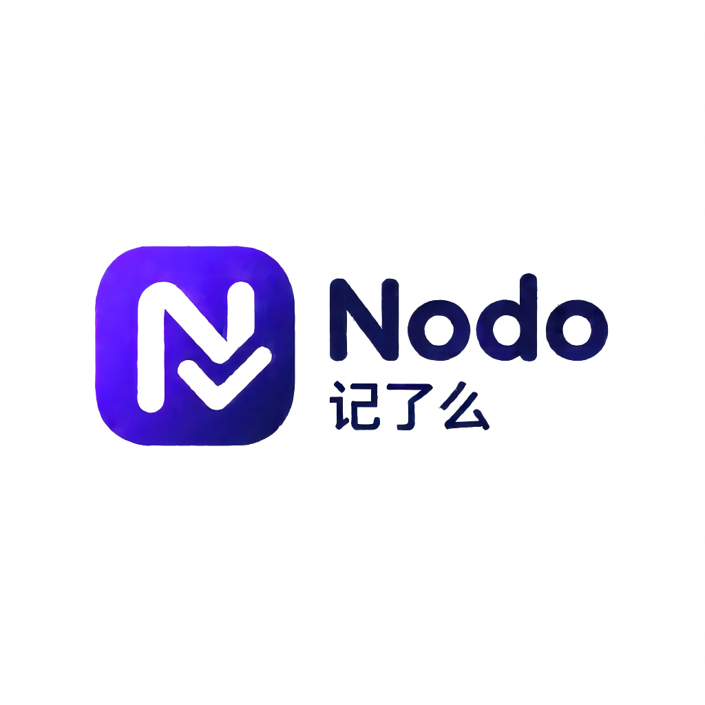

<div align="center">



# 记了么 · Nodo

**智能笔记 · 待办管理 · AI 智能助手**

一款集笔记、待办与 AI 助手于一体的跨平台桌面应用<br>
会记住你的偏好，也记得住这个世界告诉它的事实

[](https://www.electronjs.org/)
[](https://vuejs.org/)
[](https://www.typescriptlang.org/)
[](https://element-plus.org/)
[](https://www.langchain.com/)
[](LICENSE)

</div>

---

## ✨ 功能特性

### 📝 智能笔记
- **本地文件即笔记**：任意目录设为工作区，目录树浏览、新建/移动/重命名/删除一应俱全
- **安全沙箱**：所有文件操作严格限定在工作目录内，越界访问直接拒绝
- **默认软件预览**：点击文件调用系统默认程序打开，各归其位

### ✅ 待办管理
- **分组 + 待办两级结构**：分组归类、待办详情，均支持拖拽排序与置顶
- **完整生命周期**：计划起止时间、负责人/协作人、搁置、完成标记
- **灵活提醒**：开始前/后 N 分钟提醒，支持重复提醒（频率 + 次数），随时"不再提醒"
- **快速查询**：所有未完成 / 本日待办 / 所有延期 一键直达

### 🤖 AI 小助理
- **DeepAgent 智能体**：基于 LangChain DeepAgent 框架，支持工具调用、人在回路确认
- **联网检索**：接入博查（BochaAI）API，回答实时问题
- **笔记与待办操作**：增、改、查直接执行，删除需用户确认（HITL 人在回路）
- **微信接入**：绑定 ClawBot 后，微信里也能和小助理对话

### 🧠 长期记忆
- **用户画像沉淀**：每轮对话后自动提取用户的名字、身份、偏好、习惯等画像信息
- **时间衰减**：半衰期 30 天，越久远的记忆可信度越低；智能体对低可信记忆会主动向你确认
- **记忆合成**：新记忆与旧记忆由模型决策合并/更新，避免重复堆积

### 📚 知识库
- **双来源**：上传文件（docx / xlsx / pdf / md / txt，≤ 5MB）+ 对话中自动沉淀（联网检索结果等）
- **智能切片**：模型按语义切片，保持上下文连贯；MD5 去重防止重复入库
- **向量检索**：pgvector 存储，知识库优先于联网检索——先查库，查不到再上网
- **知识增删改**：新知识与旧知识由模型决策 add / update / delete / 合并，重叠内容自动整合
- **模型可选**：切片、抽取、对话模型均可单独配置

### ⚙️ 其他
- 🌗 黑夜/白天主题，支持跟随时间自动切换
- 🌍 中英文国际化，全量覆盖
- 🔐 密钥 AES-256-GCM 加密存储，强密码校验
- 🪟 窗口尺寸记忆，跨会话保持

---

## 🖼️ 界面预览

> 待补充：建议运行软件后截图，替换到 `docs/screenshots/` 目录

---

## 🏗️ 架构

```
┌────────────────────────────────────────────────┐
│                  Electron 壳                   │
│  ┌──────────────────┐  ┌────────────────────┐  │
│  │   渲染进程 (Vue 3)  │  │  内嵌后端 (Express) │  │
│  │   Element Plus    │  │  TypeORM + JWT     │  │
│  └────────┬─────────┘  └─────────┬──────────┘  │
└───────────┼──────────────────────┼─────────────┘
            │ HTTP (127.0.0.1:7070) │
            ▼                      ▼
   ┌────────────────┐    ┌──────────────────┐
   │   MySQL 业务库  │    │  PostgreSQL 向量库 │
   │ 用户/待办/笔记/  │    │  pgvector         │
   │ 会话/配置       │    │  记忆 + 知识库     │
   └────────────────┘    └──────────────────┘
            ▲
            │ LangChain / DeepAgent / BochaAI / 微信 ClawBot
```

- **业务数据**：MySQL（用户、待办、会话、配置），云端同步
- **向量数据**：PostgreSQL + pgvector（记忆、知识库切片），支持任意 OpenAI 兼容 embedding 接口
- **密钥安全**：SecretStore 基于 AES-256-GCM，按用户派生密钥加密存储

---

## 🚀 快速开始

### 环境要求

| 依赖 | 版本 |
| --- | --- |
| Node.js | ≥ 18 |
| npm | ≥ 9 |
| MySQL | ≥ 8（业务库） |
| PostgreSQL | ≥ 14（向量库，需 pgvector 扩展，记忆/知识库功能） |

### 安装与运行

```bash
# 1. 克隆仓库
git clone https://github.com/<your-name>/nodo.git
cd nodo

# 2. 安装依赖
npm install

# 3. 配置环境变量
cp .env.example .env
# 编辑 .env，填写数据库连接与 JWT 密钥

# 4. 启动开发模式（Electron + Vite 热更新）
npm run dev
```

### 环境变量说明

| 变量 | 说明 |
| --- | --- |
| `DB_HOST` / `DB_PORT` / `DB_USER` / `DB_PASSWORD` / `DB_NAME` | MySQL 业务库连接 |
| `SERVER_HOST` / `SERVER_PORT` | 内嵌后端监听地址（默认 `127.0.0.1:7070`） |
| `JWT_SECRET` / `JWT_EXPIRES` | 登录态签发密钥与有效期 |

### 构建

```bash
npm run build:win   # Windows x64 安装包
```

---

## 📦 技术栈

| 层级 | 技术 |
| --- | --- |
| 桌面框架 | Electron + electron-vite |
| 前端 | Vue 3 · TypeScript · Element Plus · Pinia · vue-i18n |
| 后端 | Express · TypeORM · MySQL · PostgreSQL/pgvector |
| AI | LangChain · DeepAgents · OpenAI 兼容接口 · 博查检索 · 微信 ClawBot |
| 文档解析 | mammoth（docx）· xlsx · pdf-parse · markdown |

---

## 📄 目录结构

```
nodo/
├── electron/               # Electron 主进程 + 内嵌后端
│   ├── server/
│   │   ├── entities/       # TypeORM 实体
│   │   ├── modules/        # 路由（auth/todo/notes/assistant/memories/knowledge/config）
│   │   ├── services/       # 业务服务（DeepAgent/记忆/知识库/提醒/微信等）
│   │   └── middleware/     # 鉴权与错误处理
│   ├── windows/            # 主窗口
│   └── preload.ts          # IPC 桥
├── src/                    # Vue 3 渲染进程
│   ├── api/                # HTTP 封装
│   ├── components/         # 组件（含小助理对话）
│   ├── views/              # 页面（待办/笔记/小助理/记忆/知识库/配置）
│   ├── i18n/               # 中英文
│   └── stores/             # Pinia
├── docs/                   # Logo 等静态资源
└── 记了么_Nodo需求文档.md    # 需求文档
```

---

## 🗺️ 路线图

- [x] 待办/笔记/小助理核心功能
- [x] 长期记忆（画像抽取 + 时间衰减 + 合成）
- [x] 知识库（文件上传 + 对话沉淀 + 向量检索 + 增删改）
- [x] 微信 ClawBot 接入
- [ ] macOS / Linux 打包适配
- [ ] Rerank 重排序检索
- [ ] OCR / TTS / ASR 多模态模型接入
- [ ] 移动端伴侣应用

---

## 🤝 贡献

欢迎 Issue 与 PR。提交前请先跑通类型检查：

```bash
npm run typecheck
```

---

## 📄 许可证

[MIT](LICENSE)

---

<div align="center">

**记了么 Nodo · 记录一切，智能待办**

</div>
